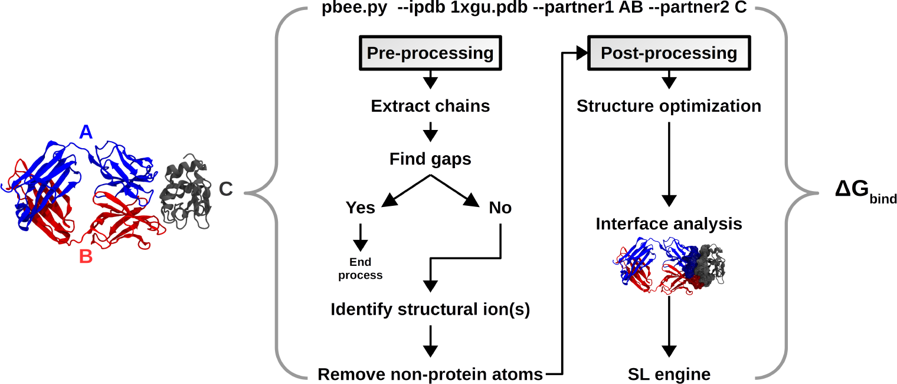
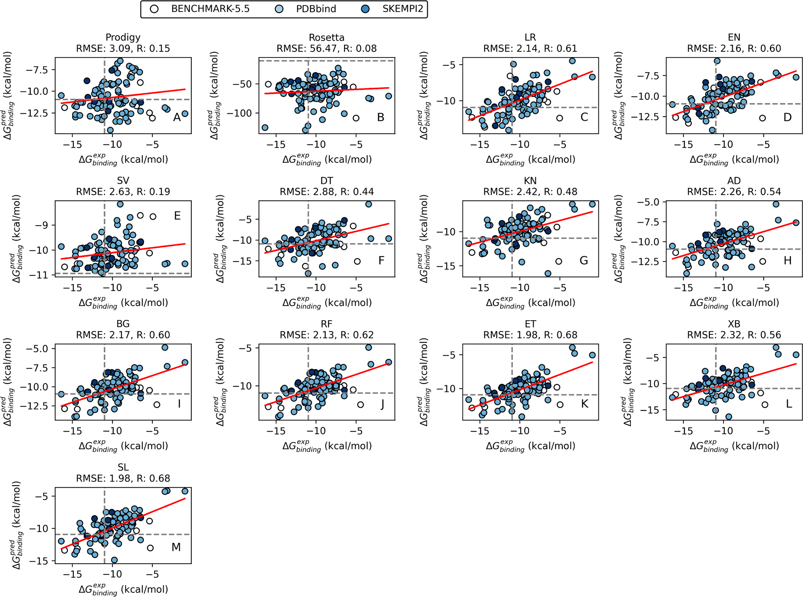
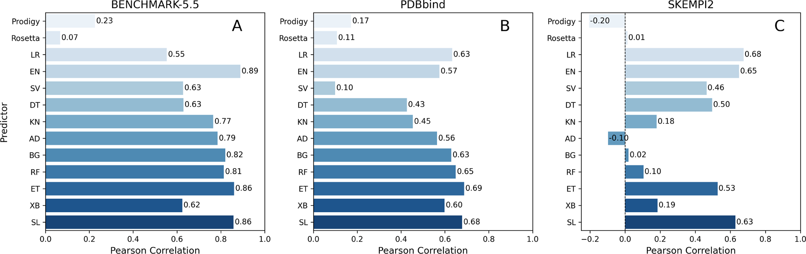
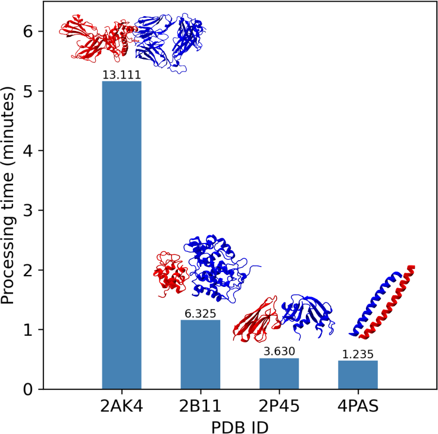
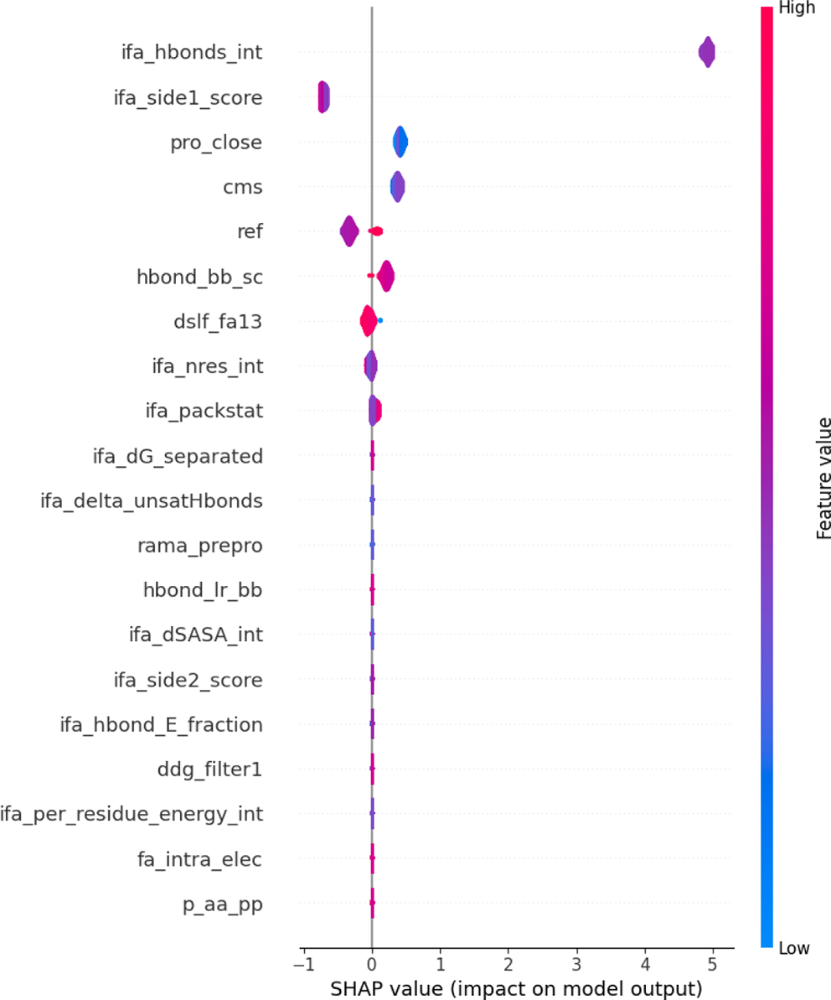

# 图表绘制说明（figure drawing spec）

每个条目都是可直接落地的绘图信息：类型、坐标轴、系列→数据键、版式、风格。标注「demo 玩具数据」的图只反映**定性趋势，不是论文数值**；「无法复现」的图会写明原因与改法，而不是伪造。

> 凡能从 PDF 抽出原图的条目都会给出「论文原图」；若同时有重绘产物，则**并排**对照，便于逐图核对差异。

## fig_f1 ← Figure 1　[无法复现 · skipped]

- **图注**：Schematic representation of the SL pipeline, which undergoes three steps. (A) The full training set is used to train 10 different ML
- **类型 / 版式**：diagram / 1x1
- **要真正复现需要**：示意/架构图：离线模式无法还原图中内容；启用 LLM 后可依据图注与方法章节生成方框-箭头示意

论文原图（无重绘产物：无法复现）

## fig_f2 ← Figure 2　[无法复现 · skipped]

- **图注**：PBEE flowchart for the protein-protein complex structure PDB ID 1XGU, corresponding to antibody (HyHEL-63) that binds to
- **类型 / 版式**：bar / 1x1
- **要真正复现需要**：需要真实实验数据；可让 demo 写出对应曲线/扫参结果（见 plan.required_outputs）后再绘制

## fig_f3 ← Figure 3　[无法复现 · skipped]

- **图注**：Regressions on the validation set using PRODIGY, Rosetta, and the trained ML and SL models (RMSE: root-mean-square error; R:
- **类型 / 版式**：bar / 1x1
- **要真正复现需要**：需要真实实验数据；可让 demo 写出对应曲线/扫参结果（见 plan.required_outputs）后再绘制

论文原图（无重绘产物：无法复现）

## fig_f4 ← Figure 4　[无法复现 · skipped]

- **图注**：Comparison of PBEE prediction accuracy by ML method to Rosetta and PRODIGY, for the three protein-protein complex data sets.
- **类型 / 版式**：line / 1x1
- **要真正复现需要**：需要真实实验数据；可让 demo 写出对应曲线/扫参结果（见 plan.required_outputs）后再绘制

论文原图（无重绘产物：无法复现）

## fig_f5 ← Figure 5　[无法复现 · skipped]

- **图注**：PBEE processing time as a function of the number of atoms
- **类型 / 版式**：bar / 1x1
- **要真正复现需要**：需要真实实验数据；可让 demo 写出对应曲线/扫参结果（见 plan.required_outputs）后再绘制

论文原图（无重绘产物：无法复现）

## fig_f6 ← Figure 6　[无法复现 · skipped]

- **图注**：Feature importance is based on SHAP-values. The violin
- **类型 / 版式**：bar / 1x1
- **要真正复现需要**：需要真实实验数据；可让 demo 写出对应曲线/扫参结果（见 plan.required_outputs）后再绘制

论文原图（无重绘产物：无法复现）

