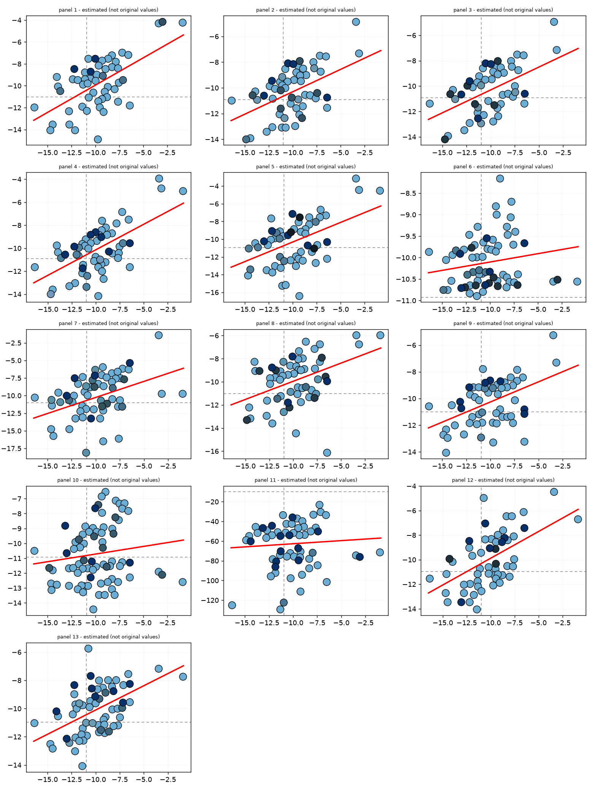
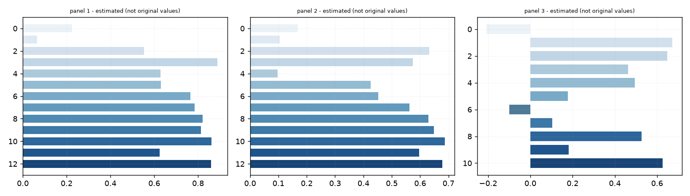
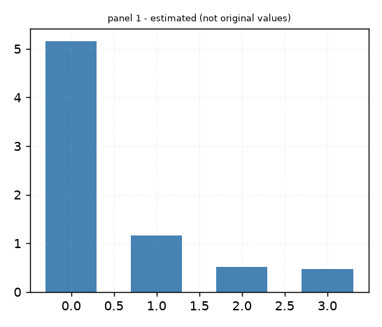
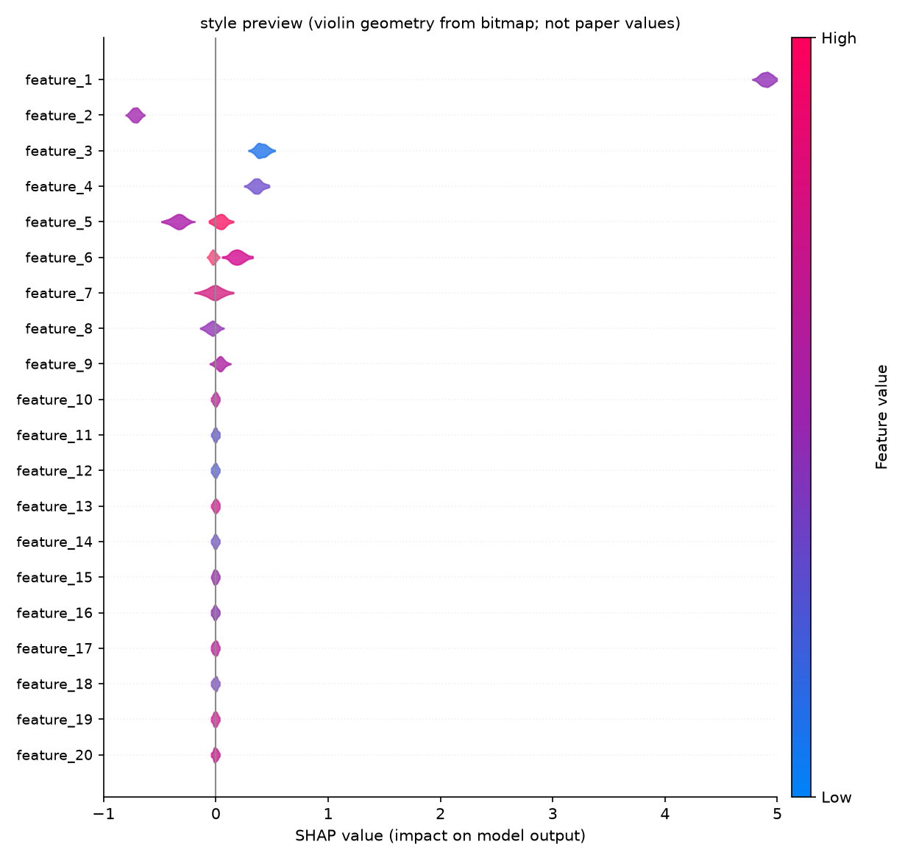

# 复现报告：Estimating Absolute Protein−Protein Binding Free Energies by a Super Learner Model

- 论文 ID：`Estimating-Absolute-Protein-Protein-Binding-Free-Energi-5e8992ab`
- 情形判定：**情形 A · 附带开源代码**（置信度 0.9）
- 判定依据：论文正文给出代码仓库链接，按「有开源代码」处理
  - 代码链接：https://github.com/chavesejf/PBEE（出处：link: https://github.com/chavesejf/PBEE. In addition, PBEE…）
  - 代码链接：https://colab.research.google.com/drive/1lu1dC0yRltKK_Wp-gF26oHcZSCiHaI8b（出处：use are available at: https://colab.research.google.com/drive/1lu1dC0yRltKK_Wp-g…）
  - 代码链接：https://colab.research.google.com/drive/1lu1d-C0yRltKK_Wp-gF26oHcZSCiHaI8b（出处：link: https://colab.research.google.com/drive/1lu1d-C0yRltKK_Wp-gF26oHcZSCiHaI8b…）
  - 正文表述：computationally demanding methods and currently available ML/DL tools. The method was encoded into an application Python

> 示例包说明：为控制体积与第三方许可，`reproduce/repo/` 的仓库克隆未随示例分发；
> `repo_manifest.json` 保留了仓库 URL 与依赖信息，重新 `git clone` 即可复现。

## 一、复现策略

论文附带开源代码，复现的第一原则是**复用而非重写**：以仓库自带的脚本与数据为准，我们只在外部做环境隔离、种子固定、产物采集与逐格对标。判据是数字级一致（默认相对误差 ≤5% 记为 pass）。失败通常来自依赖版本漂移或未固定的随机性。

【模型补充】先按README固定Python、Rosetta、PRODIGY环境与随机种子，跑通PBEE单结构流程；F1/F2用代码路径和日志核对，不重算。再从开源数据抽取Rosetta特征，按论文划分训练/验证/测试；在<1万条子集上用交叉验证重训10个基学习器与元学习器，固定子集与超参，生成F3回归散点、F4三数据集对比及性能表。F5在单机记录不同原子数的耗时与硬件；F6用同一模型计算SHAP图。主要风险：Rosetta许可/安装与算力、特征泄漏或预处理不一致、小子集使SL不稳定、PRODIGY基线缺失、SHAP与计时受版本/硬件影响。

### 执行步骤

1. 定位代码仓库（论文包 code/ 目录优先，否则用正文链接浅克隆）
2. 静态扫描仓库：入口脚本、依赖声明、数据文件、已有结果文件
3. 生成隔离环境复现脚本 repro_run.sh（锁定依赖 + 固定随机种子）
4. 在单机沙箱内执行入口脚本，采集 results/*.csv 等产物
5. 把仓库产出与论文表格逐格对齐，计算相对误差并给出 pass/warn/fail
6. 重绘论文中的图表，供人工目视比对

## 二、复现操作手册（照着做即可）

> 读法：每一步都写清了「做什么 / 怎么做 / 成功的标志 / 失败先查什么」。按顺序做完，第一次接触这个课题的人也能独立复现。

### 第 0 步 · 开跑前先备好这些

- [ ] 论文原文：`Estimating-Absolute-Protein-Protein-Binding-Free-Energi-5e8992ab/paper.md`（原始 PDF 也可以）
- [ ] 运行环境：Python 3.9 及以上；情形 A 需要仓库声明的第三方依赖（见 `repo_manifest.json` 的依赖清单），首次可能要联网安装
- [ ] 产出目录：`Estimating-Absolute-Protein-Protein-Binding-Free-Energi-5e8992ab/reproduce/` —— 下面所有相对路径都以它为起点
- [ ] 时间预期：首次跑仓库约 1–10 分钟，取决于仓库规模

### 第 1 步 · 先看清仓库里有什么（这一步不执行任何代码）

- **做什么**：打开 `Estimating-Absolute-Protein-Protein-Binding-Free-Energi-5e8992ab/reproduce/repo_manifest.json`，确认四件事都不是空的——入口脚本（entry）、依赖清单（requirements）、数据文件（data_files）、结果文件（result_files）。
- **成功的标志**：入口脚本与结果文件名都列了出来，说明这个仓库可复用。
- **失败先查**：若报告里 `repo_available` 为否，是没自动拿到仓库；手动 `git clone` 到 `Estimating-Absolute-Protein-Protein-Binding-Free-Energi-5e8992ab/reproduce/repo/` 后再重跑一次即可。

### 第 2 步 · 装依赖并跑仓库（隔离环境 + 固定种子）

- **做什么**：执行 `Estimating-Absolute-Protein-Protein-Binding-Free-Energi-5e8992ab/reproduce/repro_run.sh`。它会在隔离 venv 里装依赖、并用固定随机种子跑一遍。
```bash
bash Estimating-Absolute-Protein-Protein-Binding-Free-Energi-5e8992ab/reproduce/repro_run.sh        # Windows 下按脚本内注释逐条执行
```
- **成功的标志**：脚本跑完，目录里出现 `results/*.csv` —— 这就是待对标的产物。
- **失败先查**：①依赖装不上 / 版本漂移 → 按 `repo_manifest.json` 锁版本；②下载超时 → 本工具默认断网，确需联网时手动放行。

### 第 3 步 · 把产物与论文表格逐格对标

- **做什么**：重跑一次复现环节（`python -m paper2code run <论文>`），或直接读本报告「校验与对标明细」。
- **对齐规则**：按「首列键 + 同名列」，把仓库 CSV 的每一行对到论文表的每一行。
- **成功的标志**：明细表里出现 pass / warn / fail 条目，而不是空的。
- **失败先查**：列名对不上 → 核对 `repo_result_files` 与论文表头是否同义不同名；行对不上 → 确认首列是不是同一把主键。

### 第 4 步 · 读结论与判定口径

- 相对误差 **≤5% 记 pass**、**≤20% 记 warn**、超过记 fail。
- 结论要连着「判定依据」和 warnings 一起看：只看通过率、不看覆盖面，是最常见的误读。

### 收尾 · 怎么判断这次复现「算完成」

- **结论一句话**：报告「校验与对标明细」首行的 verdict 当前是 **not_verifiable**（pass 0 / warn 0 / fail 0 / skipped 0）。
- **完成的定义**：每一格都有明确状态（pass/warn/fail），而不是「没有 fail 就叫完成」；`skipped` 不等于通过，必须逐条看它跳过的原因。
- **产物自查清单**：
- [ ] 报告：`repro_report.md` / `repro_report.html`
- [ ] 计划：`repro_plan.json`（纯数据，可直接交给别的执行器）
- [ ] 结果：`repro_result.json`
- [ ] 重绘图：`figures/*.png|svg`


## 三、复现目标清单

| 类型 | ID | 说明 | 规模 | 角色 |
| --- | --- | --- | --- | --- |
| figure | F1 | Schematic representation of the SL pipeline, which undergoes | - | 讲解引用 |
| figure | F2 | PBEE flowchart for the protein-protein complex structure PDB | - | 讲解引用 |
| figure | F3 | Regressions on the validation set using PRODIGY, Rosetta, an | - | 讲解引用 |
| figure | F4 | Comparison of PBEE prediction accuracy by ML method to Roset | - | 图表重绘 |
| figure | F5 | PBEE processing time as a function of the number of atoms | - | 讲解引用 |
| figure | F6 | Feature importance is based on SHAP-values. The violin | - | 讲解引用 |
| figure | E1_173 |  | - | 讲解引用 |

## 四、数据输入

_未抽取到表格数据。_

## 五、仓库复用结果

- 仓库可用：是
- 仓库定位：已克隆自有仓库
- 候选仓库：https://github.com/chavesejf/PBEE（own_code）
- 复现脚本：`repro_run.sh`（隔离 venv + 固定种子）
- smoke 运行：运行失败
  - 入口：`pbee.py`
  - 原因：ModuleNotFoundError: No module named 'joblib'
- 依赖环境：未开启自动安装（仅生成脚本）
  - 安装脚本：`install_env.ps1` / `install_env.sh`

## 六、校验与对标明细

结论：**not_verifiable** ｜ pass 0 / warn 0 / fail 0 / skipped 0 ｜ 得分 0.0

_无可执行的校验项。_

## 七、图表重绘

- `preview_F3.png`
- `preview_F4.png`
- `preview_F5.png`
- `preview_F6.png`

### 位图图表取值与样式复现

> 从 PDF 中读取或识别的数值不等同于原文献数值（位图反推，仅供绘图对照）。只有坐标轴能读到 ≥2 个数值刻度、且单调、等距时才出数；读不出、对数轴、散点/蜂群过于密集的图不编造数值，但样式照原图复现并输出作图代码。

| 图 | 状态 | 置信度 | 取值 / 说明 | 识别到的样式 |
| --- | --- | --- | --- | --- |
| `F1` | 跳过 | — | 未检测到坐标轴边框（示意图、流程图或纯图片，非可标定统计图） | — |
| `F2` | 跳过 | — | 未找到该图的图片文件（PDF 里可能未提取出图资产） | — |
| `F3` | 已取数 | 0.45 | 面板 1（散点，53 个值）：(-3.03, -4.14)、(-0.913, -4.23)、(-3.41, -4.29)、(-7.21, -6.96)…；面板 2（散点，56 个值）：(-3.41, -4.85)、(-3.12, -7.31)、(-7.21, -7.48)、(-6.56, -7.53)…；面板 3（散点，52 个值）：(-3.48, -4.92)、(-3.19, -7.14)、(-7.29, -7.5)、(-6.59, -7.55)…；面板 4（散点，56 个值）：(-3.41, -3.92)、(-3.17, -4.77)、(-0.913, -5.03)、(-7.26, -6.85)…；……共 13 个面板，全部数值见 data.csv | 面板 1：点径 13.0px（约 3.7% 轴宽），描边 #020304，4 种填充色 #6aaed6、#45718c、#325063、#08306b，红色趋势线 y=0.499x-4.950，2 条灰色虚线参考线；面板 2：点径 13.0px（约 3.7% 轴宽），描边 #020405，5 种填充色 #6aaed6、#6b98b1、#46748e、#325264，红色趋势线 y=0.349x-6.819，2 条灰色虚线参考线；面板 3：点径 13.0px（约 3.7% 轴宽），描边 #020406，4 种填充色 #6aaed6、#6994aa、#203642、#08306b，红色趋势线 y=0.361x-6.697，2 条灰色虚线参考线 |
| `F4` | 已取数 | 0.97 | 面板 1（横向柱，13 个值）：0.224、0.065、0.553、0.889、0.629、0.63…；面板 2（横向柱，13 个值）：0.169、0.104、0.632、0.574、0.097、0.426…；面板 3（横向柱，11 个值）：-0.207、0.673、0.648、0.462、0.495、0.178… | 面板 1：13 根柱渐变 #ebf2f8 → #184477（自上而下）；面板 2：13 根柱渐变 #ebf2f8 → #184477（自上而下）；面板 3：11 根柱渐变 #ebf2f8 → #184477（自上而下） |
| `F5` | 已取数 | 0.97 | 面板 1（柱状，4 个值）：5.15、1.16、0.518、0.478 | 面板 1：4 根柱同色 #4682b4 |
| `F6` | 仅样式 | — | 蜂群图无法逐点还原数值；本条目复现原图的布局、小提琴轮廓与配色 | 图表类型 beeswarm（纵向蜂群/小提琴）；colorbar 配色 #fe005c → #9c23ad → #0083f8（High→Low）；作图代码 draw_F6.py（数值不取，不编造） |
| `E1_173` | 跳过 | — | 检测到 1 个边框，但均未能标定：刻度线不足 2 个 | — |

### 位图图表预览









## 八、规模约束与扩展性

- 本次复现的数据规模上限：10000 条记录
- 单次执行超时：120s
- 架构预留：执行器（reproduce.runner）与计划（reproduce.planner）解耦，后续可替换为容器/集群后端而无需改动用例定义

## 附录 A · 论文方法学自动抽取

- 完整说明书：`TECH_GUIDE.md`（与本报告同目录；确定性抽取，每条附正文出处）
- 方法流程（来源：方法部分段首的「小节标题 + 正文」写法（此刊把方法阶段嵌在段落开头））：**Data Sets** → **Structure Preprocessing** → **Structure Postprocessing** → **Geometry Optimization** → **Descriptors of Protein-Protein Association**
  - 注意：这些阶段名取自段首的小节标题（作者用的「标题式短语 + 句号」写法），顺序按正文出现次序；个别阶段可能被拆到别的段落里，请回原文核对完整性。
- 数据来源与官方入口（链接为登记值，与论文引用不一致时以论文为准）：
  - [PDBbind](http://www.pdbbind.org.cn/) —— 出处：PDBbind,27 (ii) PRODIGY,18 (iii) SKEMPI2,28 and (iv)
  - [Docking Benchmark (5.5)](https://zlab.umassmed.edu/benchmark/) —— 出处：protein-protein docking benchmark version 5
  - [SKEMPI / SKEMPI2](https://life.bsc.es/pid/skempi2) —— 出处：PDBbind,27 (ii) PRODIGY,18 (iii) SKEMPI2,28 and (iv)
  - [PRODIGY](https://wenmr.science.uu.nl/prodigy/) —— 出处：PDBbind,27 (ii) PRODIGY,18 (iii) SKEMPI2,28 and (iv)
- **结构分辨率门槛**：**晶体结构质量门槛**：分辨率数值越小、电子密度越清楚。用它筛掉低质量结构，是 X 射线结构数据集的标准做法；换数据源时必须沿用同一门槛，否则不可比。（论文原句：gaps or missing heavy atoms and with a maximum resolution of
2.5 Å）
- **去冗余**：在相似结构/复合物之间只保留一条，防止数据泄漏。（论文原句：Size of Nonredundant Data Set of Protein-Protein）
- **实验结构类型限制**：只取**实验解析**的晶体结构（区别于 NMR、冷冻电镜与预测模型），决定了数据可获取性与误差量级。（论文原句：We have initially selected 603 X-ray resolved）

## 九、注意事项

- 仓库内未找到可与论文表格直接对齐的结果文件；已生成 repro_run.sh，请先执行脚本产出 results/*.csv，再重新运行复现环节即可自动对标。
- 自动安装未开启；可执行 install_env.ps1 / install_env.sh，或加 --install-repo-deps（等价于 P2C_REPO_VENV_AUTO=1）
- 情形 A smoke 运行未跑通（运行失败）：ModuleNotFoundError: No module named 'joblib'

---

_本报告由 paper2code 自动生成。数值对标使用相对误差阈值 pass ≤ 5%、warn ≤ 20%。_